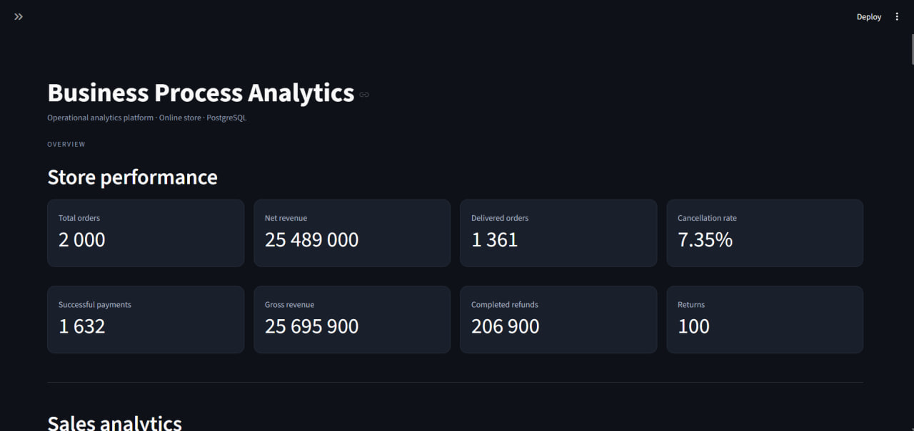
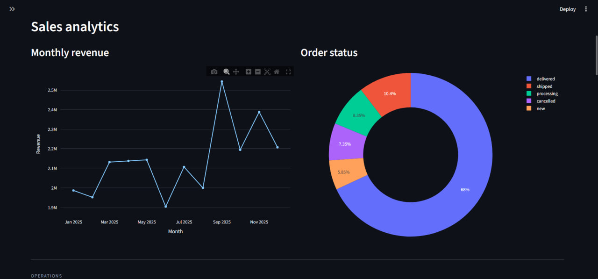
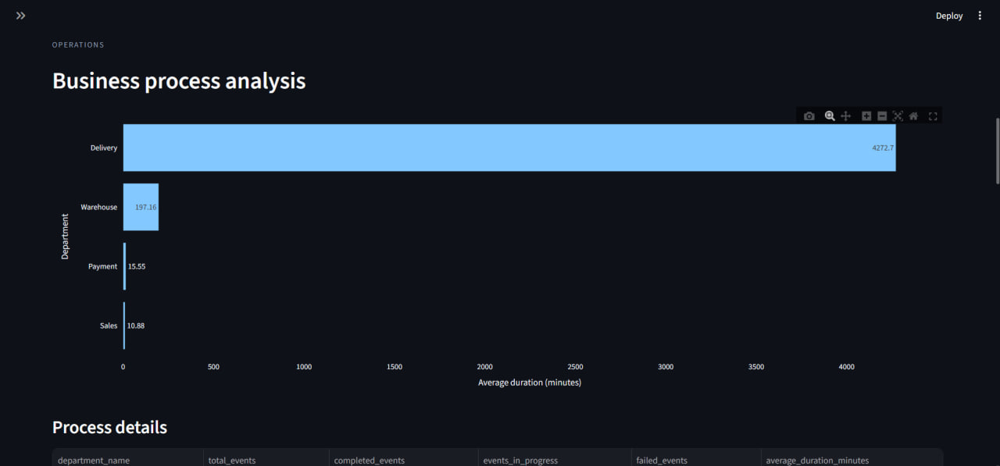
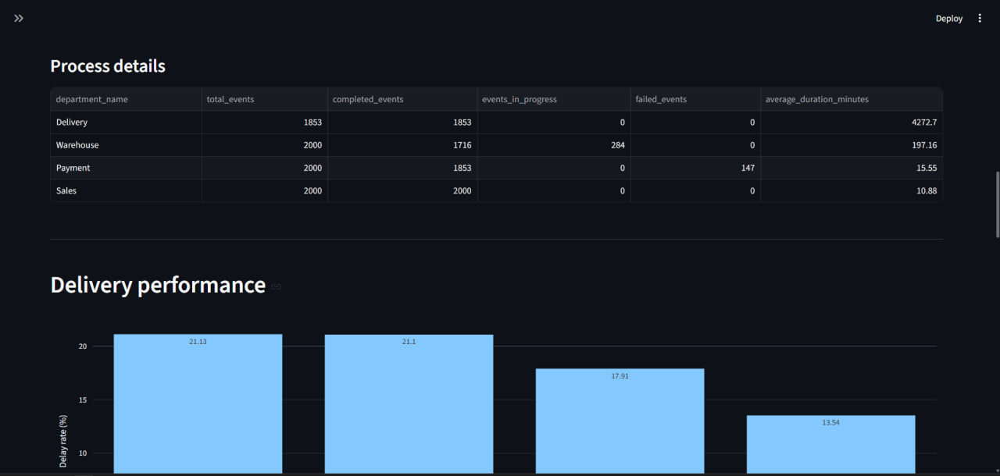
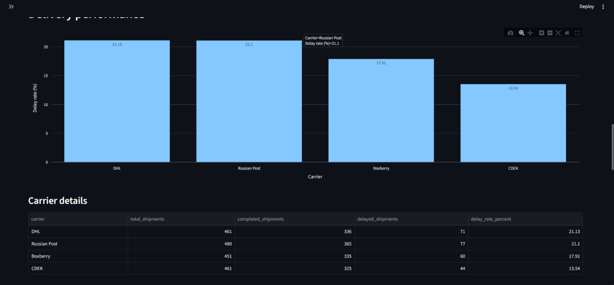
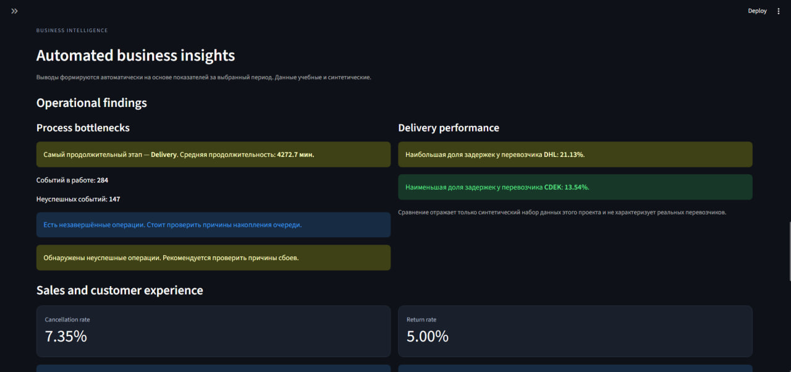
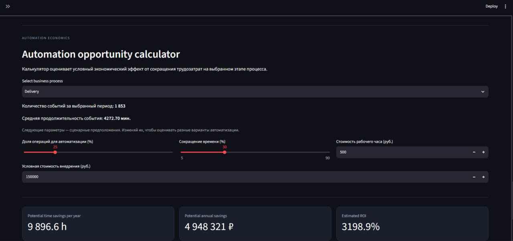
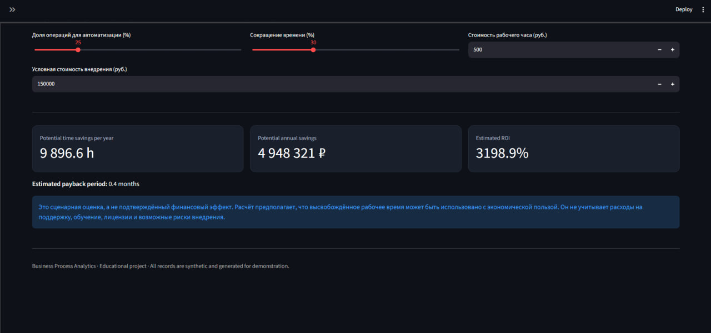

# Business Process Analytics

Учебный проект по анализу бизнес-процессов интернет-магазина. Система объединяет PostgreSQL, SQL-аналитику и интерактивный дашборд на Python и Streamlit.

Проект демонстрирует работу с данными, анализ операционных показателей, поиск потенциальных узких мест и оценку возможного эффекта автоматизации.

**Все данные синтетические. Проект не использует реальные коммерческие данные.**

## Dashboard Preview

<table>
  <tr>
    <td align="center"><b>1</b><br></td>
    <td align="center"><b>2</b><br></td>
  </tr>
  <tr>
    <td align="center"><b>3</b><br></td>
    <td align="center"><b>4</b><br></td>
  </tr>
  <tr>
    <td align="center"><b>5</b><br></td>
    <td align="center"><b>6</b><br></td>
  </tr>
  <tr>
    <td align="center"><b>7</b><br></td>
    <td align="center"><b>8</b><br></td>
  </tr>
</table>

## Technologies

- **Python** — обработка данных и бизнес-логика
- **PostgreSQL** — реляционная база данных
- **SQL** — аналитические запросы и агрегация
- **Pandas** — обработка табличных данных
- **Streamlit** — интерактивный интерфейс
- **Plotly** — визуализация показателей
- **Psycopg** — подключение к PostgreSQL
- **Git** — контроль версий

## Key Features

### Business Metrics
- Общее количество заказов, доставок и отмен
- Успешные платежи
- Валовая и чистая выручка
- Возвраты и доля отменённых заказов

### Sales Analytics
- Динамика выручки по месяцам
- Распределение заказов по статусам
- Фильтрация данных по периоду

### Business Process Analysis
Анализ четырёх этапов:
- Регистрация заказа
- Обработка платежа
- Комплектация заказа
- Доставка

Для каждого этапа рассчитываются количество операций, статусы, средняя и максимальная продолжительность.

### Delivery Analytics
Сравнение перевозчиков по количеству отправлений, завершённым доставкам и доле задержек.

### Automated Insights
Формирование аналитических наблюдений на основе заранее заданных критериев: продолжительность процессов, незавершённые операции, задержки, отмены и возвраты.

### Automation ROI Calculator
Сценарная оценка потенциального эффекта автоматизации. Пользователь может задавать долю автоматизируемых операций, сокращение времени, стоимость рабочего часа и стоимость внедрения.

Система рассчитывает потенциальную экономию времени, финансовый эффект, ROI и срок окупаемости. Все расчёты зависят от введённых предположений и не являются подтверждёнными финансовыми результатами.

## Database Structure

В базе данных используются девять основных таблиц:

| Table | Description |
|---|---|
| `customers` | Покупатели |
| `products` | Товары |
| `departments` | Подразделения |
| `orders` | Заказы |
| `order_items` | Состав заказов |
| `payments` | Платежи |
| `shipments` | Доставка |
| `returns` | Возвраты |
| `process_events` | События бизнес-процессов |

## SQL Analytics

В проекте подготовлены отдельные SQL-запросы:

| File | Purpose |
|---|---|
| `01_business_metrics.sql` | Основные показатели магазина и выручка |
| `02_delivery_analysis.sql` | Анализ доставки и задержек |
| `03_process_analysis.sql` | Анализ этапов и продолжительности процессов |

Используются JOIN, GROUP BY, агрегатные функции, фильтрация и подзапросы.

## Quick start with Docker Compose

Для запуска полного демонстрационного стенда нужны Docker Desktop и Docker Compose. PostgreSQL и Streamlit запускаются отдельными контейнерами.

1. Склонируйте репозиторий и перейдите в его папку:

```bash
git clone https://github.com/sk8teJ/business-process-analytics.git
cd business-process-analytics
```

2. Создайте локальный файл настроек:

```bash
cp .env.example .env
```

В Windows PowerShell используйте `Copy-Item .env.example .env`. Откройте `.env` и задайте собственный пароль в `DB_PASSWORD`. Не публикуйте этот файл.

3. Соберите и запустите приложение:

```bash
docker compose up --build -d
```

При первом запуске Docker создаст PostgreSQL и выполнит `database/schema.sql` для новой базы данных. После прохождения healthcheck запустится Streamlit.

4. Создайте синтетические данные:

```bash
docker compose exec app python scripts/generate_data.py
```

Генератор попросит ввести слово `REGENERATE`, потому что перед заполнением он полностью очищает демонстрационные таблицы. Для повторяемого запуска без интерактивного подтверждения можно явно передать `--yes`:

```bash
docker compose exec app python scripts/generate_data.py --yes
```

**Важно:** используйте генератор только для демонстрационной базы. Он выполняет `TRUNCATE ... RESTART IDENTITY CASCADE` и удаляет существующие записи в таблицах проекта.

5. Откройте дашборд: [http://localhost:8501](http://localhost:8501).

Проверить соединение с базой можно командой:

```bash
docker compose exec app python scripts/test_connection.py
```

Остановить контейнеры, сохранив данные:

```bash
docker compose down
```

Удалить контейнеры вместе с томом PostgreSQL и всеми данными:

```bash
docker compose down -v
```

### Локальный запуск без Docker

Создайте PostgreSQL базу `business_analytics`, настройте `.env` по примеру `.env.example`, установите зависимости и выполните схему:

```bash
python -m venv .venv
# Windows PowerShell: .venv\\Scripts\\Activate.ps1
# macOS / Linux: source .venv/bin/activate
pip install -r requirements.txt
psql -U postgres -d business_analytics -f database/schema.sql
python scripts/generate_data.py
streamlit run app/main.py
```

### Конфигурация

Приложение и скрипты используют переменные окружения `DB_HOST`, `DB_PORT`, `DB_NAME`, `DB_USER` и `DB_PASSWORD`. Для локального запуска они загружаются из `.env`; переменные, уже заданные окружением, имеют приоритет. В Docker Compose для Streamlit автоматически устанавливается `DB_HOST=db`.

## Project Structure

```text
business-process-analytics/
├── app/
│   ├── __init__.py
│   ├── main.py
│   └── metrics.py
├── database/
│   ├── schema.sql
│   └── queries/
│       ├── 01_business_metrics.sql
│       ├── 02_delivery_analysis.sql
│       └── 03_process_analysis.sql
├── scripts/
│   ├── generate_data.py
│   └── test_connection.py
├── tests/
│   └── test_metrics.py
├── .github/workflows/ci.yml
├── Dockerfile
├── compose.yaml
├── .env.example
├── requirements.txt
├── requirements-dev.txt
└── screenshots/
│   ├── 1.jpg
│   ├── 2.jpg
│   ├── 3.jpg
│   ├── 4.jpg
│   ├── 5.jpg
│   ├── 6.jpg
│   ├── 7.jpg
│   └── 8.jpg
├── requirements.txt
├── .gitignore
└── README.md
```

## Sample Dataset

Демонстрационный набор данных за 2025 год:

| Entity | Count |
|---|---:|
| Покупатели | 500 |
| Товары | 20 |
| Заказы | 2 000 |
| События процессов | 7 853 |

Примеры результатов SQL-анализа:

| Metric | Value |
|---|---:|
| Всего заказов | 2 000 |
| Доставленные заказы | 1 361 |
| Отменённые заказы | 147 |
| Успешные платежи | 1 632 |
| Валовая выручка | 25 695 900 ₽ |
| Чистая выручка после завершённых возвратов | 25 489 000 ₽ |

Результаты относятся к конкретной генерации синтетических данных и могут изменяться при повторном запуске генератора.

## Calculation assumptions and limitations

- Данные созданы искусственно для демонстрации аналитических задач.
- Автоматические выводы формируются по заданным правилам, без внешних AI-моделей.
- Доля заказов с возвратом считается по уникальным заказам, в которых есть хотя бы одна заявка на возврат. Отдельно отображается количество самих заявок.
- Средняя длительность этапа сама по себе не доказывает наличие узкого места: для полноценного анализа также нужны данные о загрузке, очередях и пропускной способности.
- ROI-калькулятор использует только завершённые события, выбранную долю автоматизации, предполагаемое сокращение времени и стоимость рабочего часа. Значения за выбранный период пересчитываются на 365 дней.
- ROI — сценарная оценка на основе пользовательских предположений, а не подтверждённый финансовый результат. Расчёт не учитывает лицензии, поддержку, обучение, риски внедрения и другие возможные расходы.
- Генератор данных очищает таблицы проекта перед повторным заполнением. Используйте его только с демонстрационной базой данных.

## Tests and continuous integration

Локальные unit-тесты расчётов:

```bash
pip install -r requirements-dev.txt
pytest -q
```

GitHub Actions автоматически проверяет Python-синтаксис, запускает unit-тесты, поднимает PostgreSQL 17, создаёт схему, генерирует синтетические данные и выполняет все три SQL-запроса. Это проверяет воспроизводимость учебного стенда, но не является нагрузочным тестированием.

## Project Status

В репозитории находятся схема PostgreSQL, генератор синтетических данных, SQL-аналитика, Streamlit-дашборд, Docker Compose-конфигурация и тесты расчётных функций.

Проект создан в образовательных целях как портфолио-кейс по бизнес-аналитике и анализу операционных процессов.